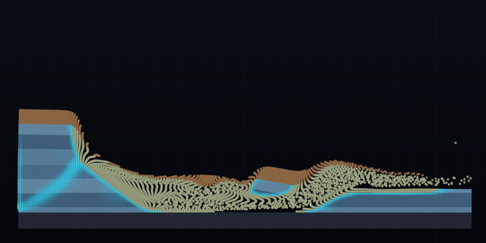
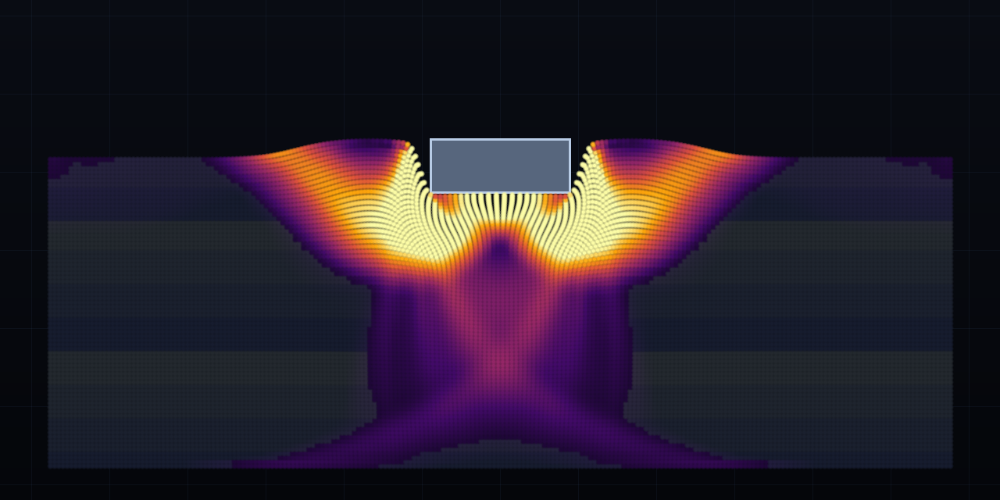
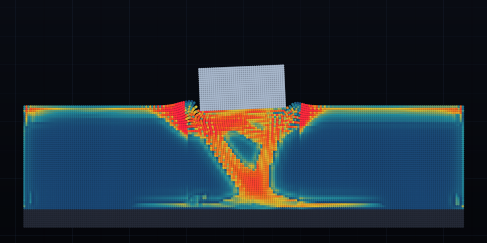
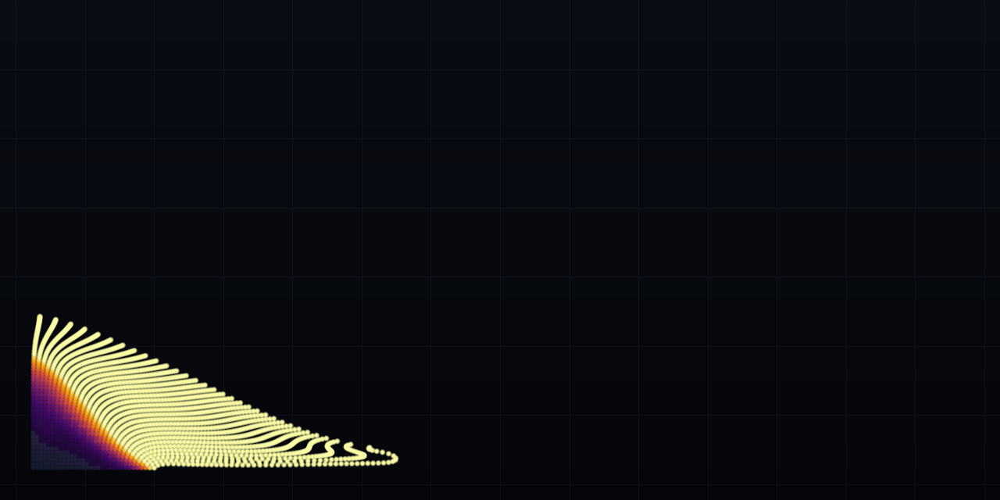

# STRATA — Finite-Strain Elastoplastic MLS-MPM Computational Geomechanics Laboratory

> **Live Interactive Browser Lab:** https://yaredwb.github.io/strata-mpm/

A zero-dependency, real-time **Moving Least Squares Material Point Method (MLS-MPM + APIC)** computational geomechanics laboratory in the browser, paired with a double-precision **C++20/OpenMP reference solver** and quantitative geotechnical verification suite.

---

## Benchmark Renders (C++20/OpenMP MLS-MPM Reference Solver)

| Nordic Quick-Clay Retrogressive Landslide ($S_t = 40$) | Prandtl–Terzaghi Strip Footing Bearing Capacity |
| :---: | :---: |
|  |  |
| *Intact crust & marine clay horst rafting on liquefied remolded clay with a fresh 45° secondary retrogressive backscarp shear band* | *Plastic deviatoric strain illuminating the triangular active wedge, radial Prandtl log-spiral fan, and Rankine passive heave flanks* |

| Seismic Soil Liquefaction & Structure Settlement ($r_u \to 1.0$) | Granular Column Collapse (Lajeunesse Benchmark, $a = 1.72$) |
| :---: | :---: |
|  |  |
| *Tied-DOF laminar shear-box base excitation driving $r_u \to 1.0$, tilting the eccentric structure with a trapped lower-$r_u$ pressure bulb* | *Static inner dead-zone wedge separated by an incandescent shear front; runout $R_\infty / R_0 = 3.55$ matches Lajeunesse (2005)* |

A 30fps H.264 simulation video of the retrogressive quick-clay cascade is included at [`renders/quick_clay_landslide.mp4`](renders/quick_clay_landslide.mp4).

---

## Quick Start

- **Online (GitHub Pages):** https://yaredwb.github.io/strata-mpm/
- **Direct local open:** open `index.html` in any modern browser (zero build step, zero external dependencies).
- **Hardened local server (`127.0.0.1` only):**
  ```bash
  node server.js
  # Opens at http://127.0.0.1:4174
  ```

---

## Computational Geomechanics Formulation

- **Spatial Discretization & Transfer:** Quadratic B-spline MLS-MPM + APIC affine velocity matrix $\mathbf{C}_p$ ($C^1$-continuous weights eliminate linear-MPM cell-crossing instabilities).
- **Finite-Strain Hyperelastoplasticity:** Exact analytic $2\times 2$ SVD ($\mathbf{F}_p = \mathbf{U}\boldsymbol{\Sigma}\mathbf{V}^T$) with Hencky logarithmic strain $\boldsymbol{\varepsilon} = \ln\boldsymbol{\Sigma}$ and principal-space return mapping:
  - **Non-Associated Plane-Strain Mohr-Coulomb** ($\phi', c', \psi$) with tensile apex projection.
  - **Nordic Strain-Softening Sensitive Quick Clay** ($s_u(\kappa) = s_{u,r} + (s_{u,0} - s_{u,r})e^{-\kappa/\kappa_{95}}$, solved by exact Newton-Raphson; $S_t$ tunable up to 80).
  - **Effective-Stress Liquefaction + 2D FLIP-Incremental Darcy Consolidation** ($\partial_t u_e = c_v \nabla^2 u_e + \dot{u}_{\text{gen}}$, tied-DOF laminar shear-box lateral boundaries during cyclic base shaking).
  - **Quasi-Static Kinetic-Damping $K_0$ Geostatic Equilibration** with rigid Dirichlet bedrock boundary nodes prior to $t = 0$.

---

## Interactive Workbench Features

- **6 Built-In Benchmarks:** *Quick-Clay Retrogressive Landslide*, *Seismic Liquefaction*, *Prandtl–Terzaghi Footing*, *Granular Column Collapse*, *Cantilever Sheet-Pile Retaining Wall*, and *Biaxial Compression Shear-Band Localization*.
- **7 Real-Time Continuum Field Views:** Stratigraphy & Quick-Clay Phase, Plastic Deviatoric Strain $\varepsilon_q^p$, Deviatoric Shear Stress $q$, Mean Effective Stress $p'$, Pore-Pressure Ratio $r_u$, Undrained Strength Ratio $s_u/s_{u,0}$, and Velocity Magnitude $|\mathbf{v}|$.
- **Tensor & Mesh Overlays:** Oriented **Principal Stress Tensor Crosses ($\sigma'_1, \sigma'_3$)**, velocity vectors, and Eulerian MPM computational grid.
- **Live Engineering Instruments:** Real-time **Mohr's Circle + Mohr-Coulomb / Softening Tresca Failure Envelope** (showing Total vs Effective stress shift under pore pressure $u$) and adaptive real-time engineering plots (Footing $q$ vs $s/B$ against analytical Prandtl–Vesic $q_u$, Lajeunesse runout scaling, $r_u$ & tilt, remolded clay %, biaxial $q$–$\varepsilon_a$).
- **Interactive Tools:** Stress Probe `[1]`, Excavator `[2]`, Pour Sand `[3]`, Pour Quick Clay `[4]`, Drop Concrete Footing Block `[5]`, Seismic Shake Table, PNG snapshot, and CSV telemetry export.

---

## Quantitative Verification

```bash
# Build and run double-precision C++20/OpenMP verification suite
g++ -O3 -std=c++20 -fopenmp reference/mpm_ref.cpp -o reference/mpm_ref
./reference/mpm_ref verify

# Run JavaScript constitutive & MLS-MPM solver unit tests
node reference/test_js_geomech.mjs
```

| Benchmark | Computed | Reference | Error / Status |
| :--- | :---: | :---: | :---: |
| Analytic $2\times 2$ SVD $\|\mathbf{U}\boldsymbol{\Sigma}\mathbf{V}^T - \mathbf{F}\|_\infty$ | `0.000000` | `0.0` | `5.55e-17` |
| Non-Associated Mohr-Coulomb Consistency $\|f(\boldsymbol{\sigma})\|$ | `0.000000 Pa` | `0.0 Pa` | `9.09e-12` |
| Quick-Clay Newton-Raphson Softening $\|q - s_u(\kappa)\|$ | `0.000000 Pa` | `0.0 Pa` | `0.00e+00` |
| Liquefied Sand Strength Collapse ($r_u = 1.0$) | `0.000000 Pa` | `0.0 Pa` | `0.00e+00` |
| Prandtl Undrained Bearing Factor $N_c(\phi=0)$ | `5.141593` | $2 + \pi$ | `0.00e+00` |
| Intact $K_0$ Quick-Clay Slope Equilibrium | `max \|v\| = 0.096 m/s` | `< 0.35 m/s` | PASS |
| Granular Column Collapse Runout $R_\infty / R_0$ ($a = 1.72$) | `3.546` | Lajeunesse (2005): `3.136` (`2.2–4.1`) | PASS |

## License

MIT License — see [`LICENSE`](LICENSE).
